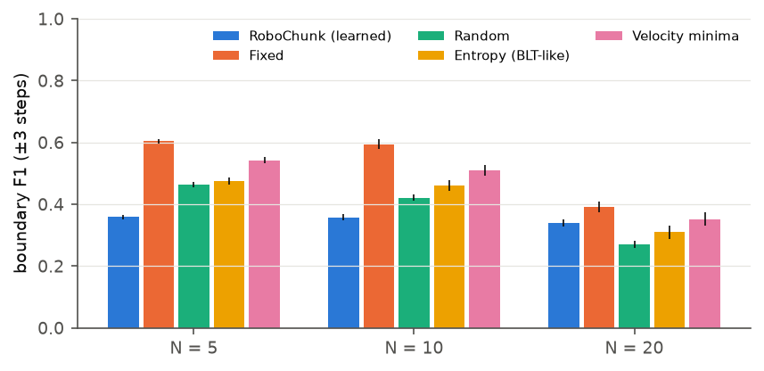
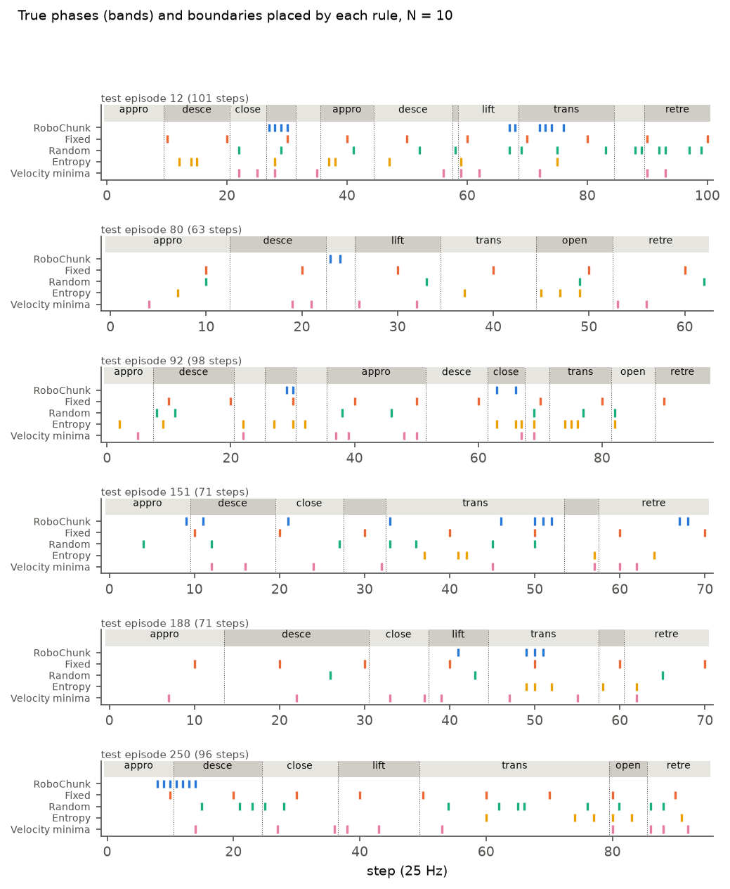
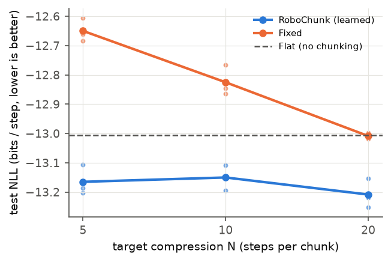
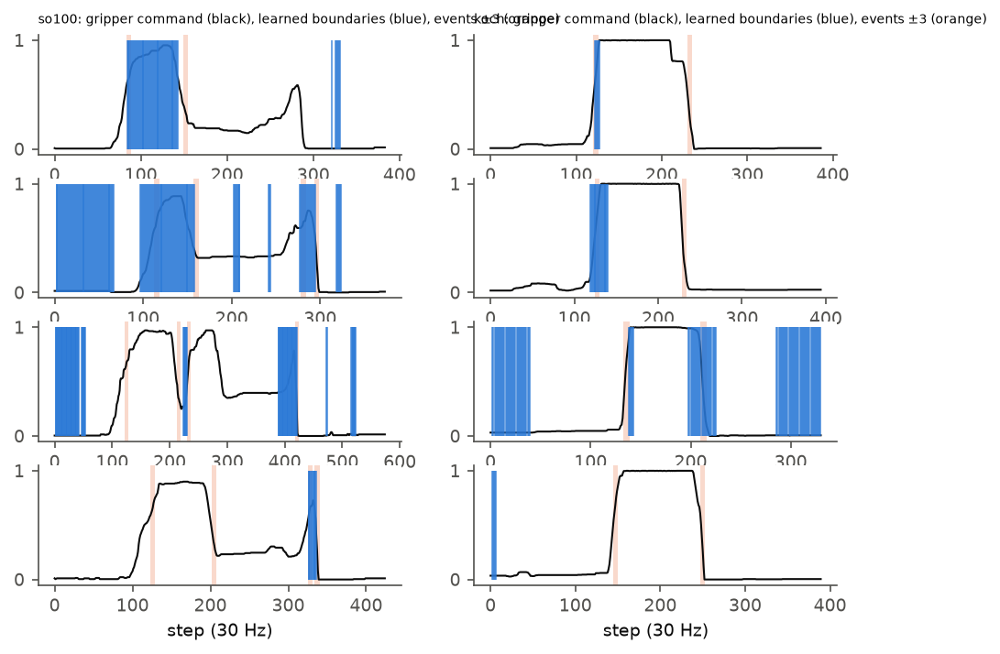
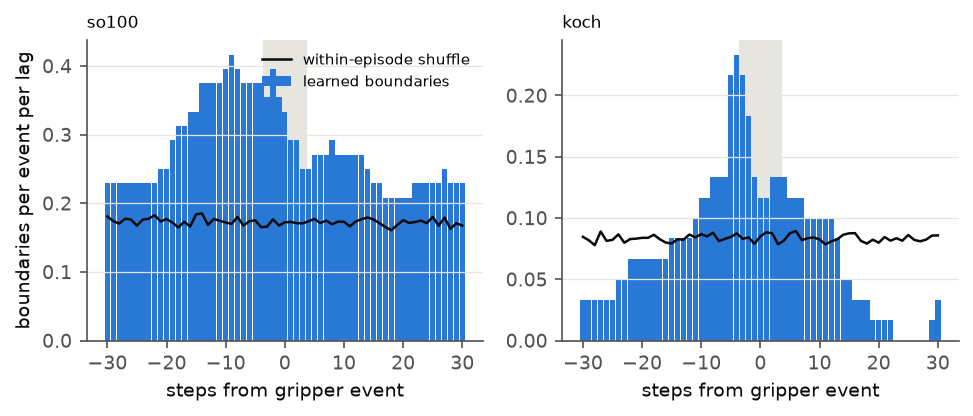
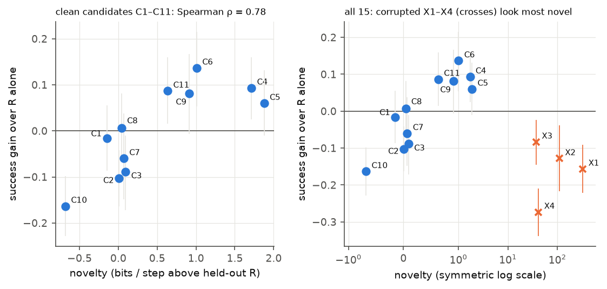
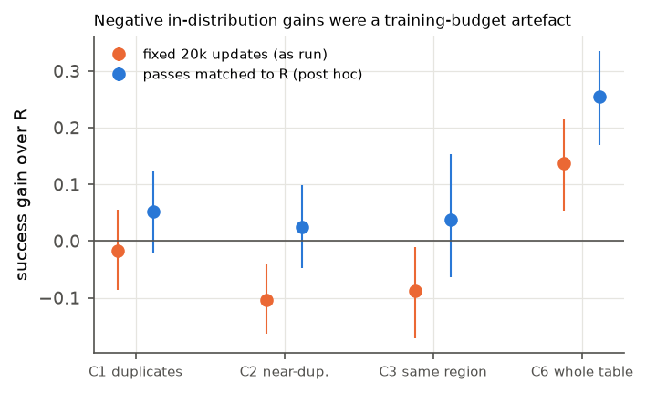
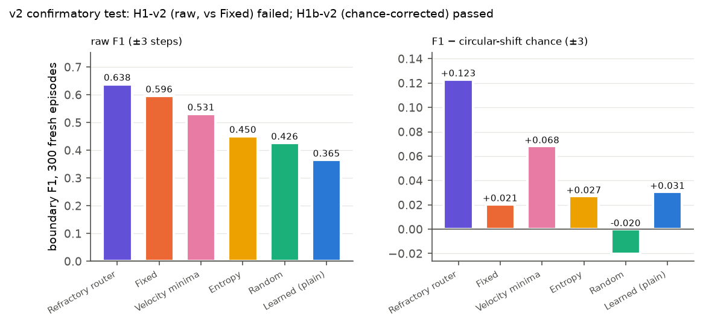

# RoboChunk — report

Author: Téo Tran Van Lieu. Generated by `scripts/make_report.py` from the result files in `runs/`. Pre-registrations: `PREREGISTRATION.md` (tags `prereg`, `prereg-amend1`) and `PREREGISTRATION_v2.md` (tag `prereg-v2`). Anything not pre-registered is labelled **exploratory** or **post hoc**.

## Summary

| Test | Question | Verdict |
|---|---|---|
| H1 | Learned boundaries beat every baseline on motion-phase F1 by ≥ 0.10 (sim) | **FAIL** |
| H2 | Learned chunking predicts the next step better than fixed chunking at matched compression (≥ 2 of 3 N) | **PASS** |
| H3 | Real teleop: boundaries ≥ 2× chance near gripper events on both datasets | **significant but below threshold** (pre-registered verdict: not supported) |
| H4 | Compression novelty predicts BC policy gain, Spearman ρ ≥ 0.6 over 11 clean candidates | **PASS** |
| H1-v2 | Refractory router beats every baseline by ≥ 0.10 raw F1 (fresh sim data) | **FAIL** |
| H1b-v2 | Same, chance-corrected F1 (circular shift), every difference > 0 with CI excluding 0 | **PASS** |
| H3-v2 | Refractory router ≥ 2× chance near gripper events, SO-100 and Koch | **not supported** |
| H3b-v2 | Same on a fresh dataset (SO-101) | **FAIL** |

In one paragraph: the H-Net router, used as designed, does not find motion phases in simulation (H1), but it does compress trajectories better than fixed chunking (H2). A post-hoc fix — no new boundary within 3 steps of the last one (the *refractory router*) — gives phase information beyond chance that replicated on fresh data (H1b-v2), but its raw lead over a fixed grid stays small (H1-v2 failed, as predicted). On real robots every router variant lands between 1.52× and 1.89× chance near gripper events, never 2×. Compression novelty ranks clean candidate datasets by policy gain (H4), but scores corrupted data as the most novel of all, and part of the correlation came from a training-budget artefact found post hoc.

## Part A — simulation (FetchPickAndPlace, scripted expert, 300 test episodes)

### H1: boundary F1 at ±3 steps, N = 10

| method | F1 (mean of 3 seeds) | per seed |
|---|---|---|
| Learned router (plain) | 0.358 | 0.389, 0.210, 0.474 |
| Fixed | 0.594 | 0.594, 0.594, 0.594 |
| Random | 0.422 | 0.412, 0.432, 0.421 |
| Entropy | 0.462 | 0.462, 0.462, 0.462 |
| Velocity minima | 0.510 | 0.510, 0.510, 0.510 |

Learned − baseline (95% paired bootstrap CI): Fixed −0.236 [−0.253, −0.219]; Random −0.064 [−0.078, −0.049]; Entropy −0.104 [−0.122, −0.085]; Velocity minima −0.152 [−0.171, −0.132]. Verdict **FAIL**. Ablations at N = 10: with object state F1 0.483, conv encoder 0.309.

The learned router fires in bursts of adjacent boundaries; one-to-one matching counts the extras as false positives.

### H2: next-step prediction, bits per step (lower is better)

| N | learned | Fixed | learned compression | counts |
|---|---|---|---|---|
| 5 | -13.165 | -12.650 | 4.5 | win |
| 10 | -13.150 | -12.825 | 8.5 | win |
| 20 | -13.208 | -13.009 | 15.5 | fail (compression below 0.8 N) |

Verdict **PASS** (2 of 3). Flat model (no chunking), 3 seeds: -13.006 bits per step.

## Part A — real teleoperation (H3, N = 12, ±3 steps = 0.1 s)

| dataset | test episodes | share of boundaries near an event | chance share | ratio | p | Fixed ratio | Entropy ratio |
|---|---|---|---|---|---|---|---|
| SO-100 | 5 | 0.099 | 0.052 | 1.89× | 0.001 | 0.65× | 1.77× |
| Koch | 10 | 0.071 | 0.040 | 1.77× | 0.001 | 1.05× | 10.27× |

Verdict **not supported**: significant on both datasets, below the pre-registered 2×. Per-seed shares on Koch: 0.110, 0.114, 0.000 (one seed placed no boundary near any event).

## Part B — does compression novelty predict data value? (H4)

| candidate | novelty (bits/step) | gain in success (95% CI) |
|---|---|---|
| X1 | 326.823 | −0.157 [−0.222, −0.092] |
| X2 | 109.991 | −0.128 [−0.217, −0.038] |
| X4 | 41.619 | −0.273 [−0.338, −0.210] |
| X3 | 37.306 | −0.083 [−0.145, −0.023] |
| C5 | 1.877 | +0.060 [−0.010, +0.132] |
| C4 | 1.714 | +0.093 [+0.025, +0.160] |
| C6 | 1.009 | +0.137 [+0.053, +0.215] |
| C9 | 0.915 | +0.082 [−0.007, +0.167] |
| C11 | 0.635 | +0.087 [+0.015, +0.160] |
| C3 | 0.093 | −0.088 [−0.172, −0.010] |
| C7 | 0.069 | −0.060 [−0.148, +0.038] |
| C8 | 0.041 | +0.007 [−0.067, +0.082] |
| C2 | 0.009 | −0.103 [−0.163, −0.042] |
| C1 | -0.148 | −0.017 [−0.087, +0.055] |
| C10 | -0.681 | −0.163 [−0.228, −0.098] |

Base success of BC on R alone: 0.437. Spearman ρ over C1–C11 = 0.782 (p = 0.0045), verdict **PASS**. 95% CI for ρ (post hoc, n = 11): Fisher z with Bonett–Wright SE [0.25, 0.95], bootstrap over candidates [0.35, 0.95] — both include values below the 0.6 threshold.

Pre-registered failure mode: holds for 4 of 4 corrupted candidates (novelty above the median and no gain). **Novelty finds new data, not good data.** Comparison scores: Flat-model novelty ρ = 0.764, nearest-neighbour novelty ρ = 0.527 (p = 0.096); chunking adds little over an unchunked model here.

### Post hoc: the negative in-distribution gains

BC trained for a fixed 20,000 updates, so adding 200 episodes cut passes over the data from 260 to 186. Retrained with passes matched to R (gain vs R as run): C1 +0.052 [−0.020, +0.123]; C2 +0.025 [−0.048, +0.098]; C3 +0.038 [−0.063, +0.153]; C6 +0.255 [+0.170, +0.335]. The negative gains of C2 and C3 disappear, so they were a training-budget artefact, and they helped ρ. Excluding C1–C3, ρ = 0.690 (n = 8, p = 0.058). The H4 verdict stands as scored.

## v2 — confirmatory test of the refractory router (fresh data, frozen before running)

| method | F1 ±3 | F1 ±1 | circular-shift chance ±3 | F1 − chance ±3 | per seed F1 ±3 |
|---|---|---|---|---|---|
| Refractory router | 0.638 | 0.395 | 0.515 | +0.123 | 0.690, 0.584, 0.641 |
| Refractory, new seeds 3–5 | 0.609 | 0.359 | 0.502 | +0.108 | 0.604, 0.644, 0.580 |
| Learned router (plain) | 0.365 | 0.203 | 0.334 | +0.031 | 0.408, 0.211, 0.475 |
| Fixed | 0.596 | 0.287 | 0.575 | +0.021 | 0.596 |
| Velocity minima | 0.531 | 0.299 | 0.463 | +0.068 | 0.531 |
| Entropy | 0.450 | 0.268 | 0.423 | +0.027 | 0.450 |
| Random | 0.426 | 0.219 | 0.446 | −0.020 | 0.425, 0.427, 0.425 |

Refractory − baseline (95% CI). H1-v2, raw F1: Fixed +0.042 [+0.023, +0.061]; Random +0.212 [+0.198, +0.227]; Entropy +0.188 [+0.168, +0.208]; Velocity minima +0.107 [+0.089, +0.127] → **FAIL** (Fixed below 0.10, as predicted). H1b-v2, chance-corrected: Fixed +0.103 [+0.084, +0.122]; Random +0.143 [+0.130, +0.156]; Entropy +0.096 [+0.078, +0.115]; Velocity minima +0.055 [+0.038, +0.072] → **PASS**.

Bits per step on the fresh set: refractory -13.204, Fixed -12.931 (refractory compression 9.0).

| real dataset | test episodes | gripper events | ratio | p | event recall per seed | stop reasons |
|---|---|---|---|---|---|---|
| SO-100 | 5 | 16 | 1.53× | 0.001 | 0.88, 0.94, 0.62 | early_stop, early_stop, early_stop |
| Koch | 10 | 20 | 1.52× | 0.001 | 0.70, 0.75, 0.75 | early_stop, time_budget, time_budget |
| SO-101 (fresh) | 5 | 8 | 1.74× | 0.004 | 0.62, 0.75, 0.62 | early_stop, early_stop, early_stop |

H3-v2 **not supported**, H3b-v2 **FAIL**. The refractory rule did not help on real data.

## Exploratory findings

- **Surprise (entropy) rule as a gripper-event detector.** Koch: 10.3× chance, event recall 1.00. SO-100: 1.77×. SO-101 (v2 secondary): 3.99× (p = 0.001), event recall 0.875. Promising on two of three datasets, each with 5–10 test episodes.
- **Refractory router on the v1 test split** (exploratory before v2): F1 0.630, F1 − uniform-shuffle chance +0.176 at ±3.
- Full tables (chance-corrected and burst-merged F1, phase density, burst locations): `docs/EXPLORATORY.md`.

## Deviations from the pre-registration and other disclosures

- **Amendment 1** (before any main result): likelihood floor σ = 0.1, a separate action-noise RNG with all data regenerated, the Random rule's rate, the pilot redone, and new training budgets. Listed in `PREREGISTRATION.md`.
- **Threads per job** changed during the main runs (1 thread instead of 6, Flat 6); losses are bit-identical across thread counts and no run was interrupted (`DECISIONS.md`).
- **Runs stopped by the time budget** instead of early stopping: real_koch_fixed_N12_s0, real_koch_fixed_N12_s2, real_koch_learned_N12_s0, real_koch_learned_N12_s1, real_koch_learned_N12_s2, v2_real_koch_refractory_N12_s1, v2_real_koch_refractory_N12_s2.
- **Entropy baseline on real data** uses one proxy model per dataset, so its three "seeds" are identical.
- **Analyses added after the pre-registration** (chance-corrected F1, burst merging, refractory router, the v2 study, the H4 diagnostics) are labelled exploratory or post hoc and never change a v1 verdict.
- **Git history** was rewritten once before publication to remove a personal e-mail address from a document; the old→new commit map is in `docs/HISTORY.md`, and the tags point to the rewritten commits.
- **Small test sets** on real data: SO-100 and SO-101 have 5 test episodes each, Koch 10.

## Credits

The model follows **H-Net** (Sukjun Hwang, Brandon Wang, Albert Gu, *Dynamic Chunking for End-to-End Hierarchical Sequence Modeling*, arXiv:2507.07955) and Cartesia's posts on dynamic chunking. Independent re-implementation, not affiliated with the H-Net authors or Cartesia. Simulation: Gymnasium-Robotics and MuJoCo. Real data: LeRobot community datasets (`lerobot/svla_so100_pickplace`, `lerobot/koch_pick_place_1_lego`, `lerobot/svla_so101_pickplace`), read at pinned revisions and not redistributed. Code written with Claude (Anthropic) as a coding agent.
